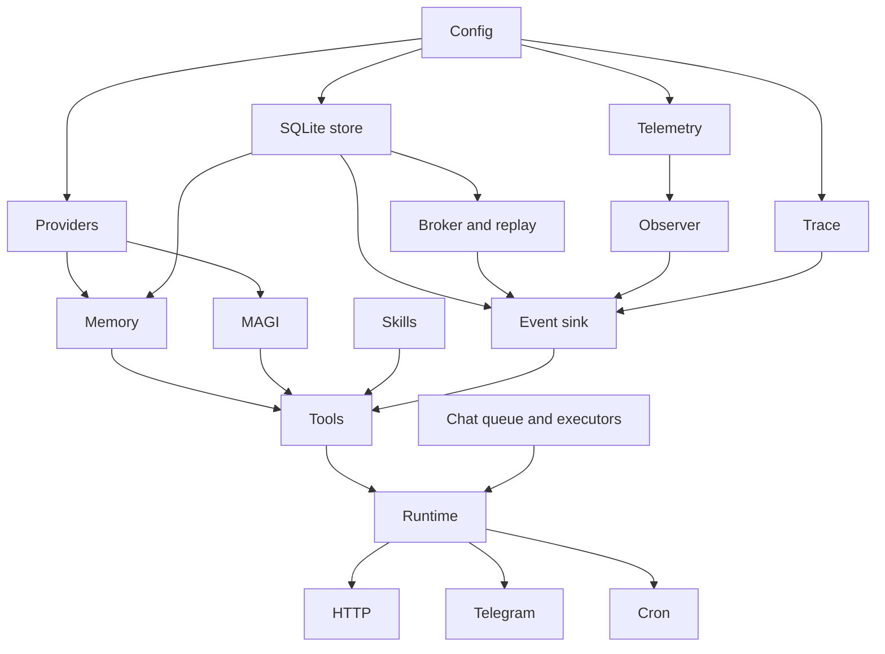

# Developing Iris

## Component graph and ownership

`agent.system` owns lifecycle; `agent.system.components` wires dependencies.
Startup and soft reload share `rebuild-runtime-components`. Avoid adding a
second dependency list in a reload handler.



The live `:system-ref` belongs to one system. MAGI resolves the current tool
registry through that reference; it must not capture a stale registry. Facades
such as `agent.chat`, `agent.memory.core` and `agent.persistence.sqlite` preserve
public contracts. Implementation namespaces may share small lower-level modules,
but should not require their own facade and create a dependency cycle.

| Owner | Resource | Release |
|---|---|---|
| System | SQLite pool | `close-system!`, after runtime edges stop |
| Chat service | Turn/loop executors, stream scheduler, queue and cancellation state | `chat/stop!` |
| API startup | HTTP server and started adapters/background workers | Reverse-order rollback on startup failure |
| Cron service | Scheduler and worker pool | `cron/stop!` |
| Memory idle/review service | Background futures | Corresponding `stop!` |
| SSE response | Subscription, worker, HTTP channel | Registered stream cleanup |
| Telegram turn | Broker subscription and result channel | Turn cleanup/finally |
| UI state | Client stream ownership | Stream cleanup and `ui-state/close!` |

Factories register closable resources with `agent.system.resources/with-rollback`.
A successful scope transfers ownership to its caller; a failed scope releases
resources in reverse order. Mutable services are registered **before** starting
them, so partially started services are covered. Cleanup errors are suppressed
on the original exception rather than replacing it.

Normal shutdown closes UI streams, cron/review/idle workers, chat, Telegram,
HTTP, then SQLite. Full reload temporarily keeps the old chat queue alive for
rollback, then closes it after successful replacement. See the
[reload matrix](configuration.md#reload-boundaries) for retained components.

## Runtime changes

`runtime.turn-policy` owns pure decisions and `advance`, the common next-turn
state builder. `runtime.loop` performs planning, tool calls, buffer flush/discard
and ordered event emission. Submission and execution each have a bounded helper.
Retry prompts belong to planner history; only emitted protocol messages enter
final history. Do not fix duplication by moving side effects into policy.

Preserve complete tool calls when the provider reports output-length truncation.
A required persistence failure must abort success and must not trigger a second
provider fallback. Cancellation is request-owned: late completion of one request
must not clear another request's stream.

## Checks

Run the normal suite, which discovers tests and creates a temporary Iris home:

```bash
clojure -M:test -m agent.test-runner
clj-kondo --lint src test dev/user.clj scripts/benchmark_branch_path.clj scripts/benchmark_broker.clj
git diff --check
```

`clojure -M:test` alone opens a REPL. `run-all-tests` returns a result map;
`-main` converts failures/errors to a nonzero process exit. CI uses `-main`.
`scripts/check-test-runner-exit.sh` deliberately creates one failing test and
verifies exit 1, then removes its temporary probe. Its printed failure is expected.
The active Tests and lint workflow has no deployment or notification steps.

Focused tests with the same isolation and exit handling:

```bash
clojure -M:test -e '(require (quote agent.test-runner)) (let [r (agent.test-runner/with-isolated-home (fn [] (require (quote agent.system.lifecycle-test) :reload) (clojure.test/run-tests (quote agent.system.lifecycle-test))))] (System/exit (if (zero? (+ (:fail r) (:error r))) 0 1)))'
```

For a persistent development nREPL, use `clj-nrepl-eval --discover-ports`; require
changed namespaces with `:reload`. Reload facades too when they alias functions
using `def`. Do not evaluate fault-injection tests in a production REPL:
`with-redefs` changes Vars JVM-wide. Keep test DBs inside isolated directories and
close pools before deleting their files.

Lifecycle tests inject faults after resource acquisition and while starting
replacement services. Streaming tests force buffer overflow and lost terminal
events. Test the actual restored state and released resources, not only that an
exception was thrown. See `test/agent/system/lifecycle_test.clj`,
`test/agent/audit_maintenance_test.clj` and `test/agent/audit_regression_test.clj`.

## Performance

```bash
clojure -M:test scripts/benchmark_branch_path.clj
clojure -M:test scripts/benchmark_broker.clj
```

The branch benchmark seeds isolated SQLite databases, compares complete ordered
results with the prior algorithm, warms both paths and reports median time and
number of decoded entries. Ancestor reads use a recursive CTE scoped by session;
ordering is reconstructed from parent links. `UNION` bounds corrupt cycles and the
reader reports them explicitly. Compaction and context exclusion happen after
path selection. Changes to that policy need separate tests.

The broker benchmark compares 100 all-event subscribers with 100 session
subscribers over 500 events. Exact subscriptions are indexed; wildcard consumers
remain supported. Report delivery counts as well as time. Neither benchmark
measures LLM latency, network delivery or production throughput.

## Acceptance boundaries

- JVM tests: lifecycle, queue, SQL, serialization and controlled streaming scenarios.
- Browser: real reconnect, DOM updates, history-window preservation, navigation.
- Telegram: actual delivery, formatting, cancellation and completion on the transport.
- Production: deployed artifact identity, health and sustained interaction/load.

A passing local suite does not prove the last three. Release smoke is opt-in with
`AGENT_RELEASE_SMOKE=1`; it is not silently counted as passed by the normal runner.
